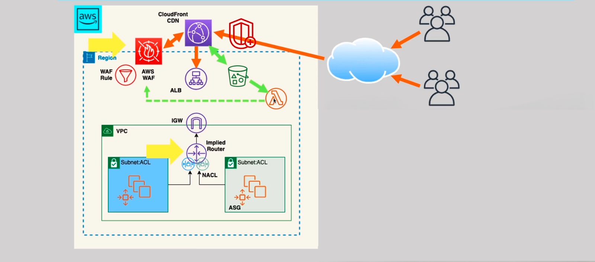

# AWS Secure Web App with WAF Automation

## 📌 Overview
A production-grade security architecture for a two-tier web application hosted on AWS. This project demonstrates how to enhance the security posture of a web application, mitigate DDoS attacks, and implement an automated incident response system using AWS WAF, CloudFront, and Lambda.

## 🏗️ Architecture Diagram


## 🎯 Requirements Covered
1. **Two-Tier Web App:** Auto-scaled fleet of EC2 instances (in public subnets) behind an Application Load Balancer (ALB) across two Availability Zones.
2. **Enhanced Security:** Implementation of AWS WAF (Web Application Firewall) integrated with CloudFront to protect against common web vulnerabilities (Layer 7).
3. **DDoS Mitigation:** Utilization of AWS Shield Standard (automatic) and WAF Rate Limiting rules to minimize the impact of internet-generated attacks.
4. **Layer 4 Security:** Restricting EC2 Security Groups to accept traffic **only** from the ALB, and implementing strict Network ACLs.
5. **Automated Incident Response (SOAR):** CloudFront Access Logs are sent to S3, triggering a Lambda function that parses the logs, detects blocked IPs, and is designed to automatically update WAF/NACL rules to block malicious actors.
6. **Cost-Effective:** Used only necessary resources to minimize ongoing overhead in the lab environment.

## 🔧 AWS Services Used
| Service | Purpose |
|---------|---------|
| Amazon VPC | Network isolation (2 Public Subnets, IGW, Route Tables) |
| Amazon EC2 (ASG) | Web/App compute tier (Auto Scaling Group) |
| Application Load Balancer | Traffic distribution across AZs |
| Amazon CloudFront | CDN and entry point for WAF protection |
| AWS WAF | Web Application Firewall (Rate limiting, Geo-blocking) |
| Amazon S3 | Storage for CloudFront Access Logs |
| AWS Lambda | Serverless automation for log parsing and security response |
| AWS IAM | Access control for Lambda automation |

## 📂 Repository Structure
```text
.
├── architecture/          # Architecture diagrams
├── screenshots/           # AWS Console screenshots (proof of implementation)
├── documentation/         # Requirements & design decisions
├── testing/               # Connectivity & validation tests
└── infrastructure-as-code/ # (Planned) Terraform implementation# AWS Secure Web App with WAF Automation
```
🛠️ Implementation Summary
Manual Provisioning: All resources were manually provisioned via the AWS Management Console.

Security Testing: Validated the WAF Rate Limit rule by simulating a DDoS attack (multiple rapid requests), which successfully resulted in a 403 Forbidden block.

Automation Proof of Concept: Confirmed that CloudFront logs are successfully delivered to S3, triggering the Lambda function which processes the logs.

📸 Screenshots
All 22 implementation screenshots are available in the screenshots/ folder.

📘 Lessons Learned
Security is layered: NACLs (Subnet) -> Security Groups (Instance) -> WAF (Application).

The ALB should be the only resource exposed to the internet; EC2 instances should only trust the ALB.

Serverless automation (Lambda + S3 Triggers) provides a powerful and cost-effective way to build a Self-Healing Security system (SOAR).

🚀 Future Enhancements
Infrastructure as Code: Automate the entire infrastructure using Terraform.

Full Automation: Update the Lambda code to actually push the blocked IPs into a WAF IP Set and NACL Deny rules.

Security Hub: Integrate AWS Security Hub for centralized security monitoring.

📄 License
This project is licensed under the MIT License - see the LICENSE file.

👤 Author
Mohammed Al-Bayati

GitHub: @MohammedAlbayati1983
